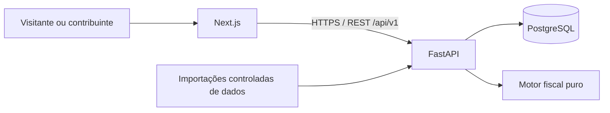

# Arquitetura da V1

## Stack e organização

Monorepo com frontend Next.js + TypeScript (App Router) e backend FastAPI + Pydantic + SQLAlchemy 2 + Alembic. PostgreSQL é a fonte de verdade. O backend é um monólito modular; o motor fiscal é Python puro, independente de HTTP, banco e interface.

Node.js 22 e Python 3.12 são as versões do ambiente inicial. npm workspaces gerencia o frontend; uv gerencia o backend. Lockfiles são versionados. Docker Compose oferece PostgreSQL 17, migrations, API, frontend e limpeza de logs para uso local; [operação Docker](../development/DOCKER_LOCAL.md). Hospedagem permanece em aberto. A interface usa CSS nativo com tokens e componentes React, Bricolage Grotesque + DM Sans via next/font e temas claro/escuro; ver [docs/design/DESIGN.md](../design/DESIGN.md). O simulador da home é uma demonstração local com valores fictícios; propostas e planos usam o motor fiscal e as regras da API.

## Diretórios

Frontend: `src/app` para rotas/layouts, `src/features` para domínio, `src/components` para UI compartilhada e `src/lib` para infraestrutura. Criar camadas adicionais quando houver uso concreto.

Backend: `app/core` (configuração e HTTP), `app/database` (base e sessões), `app/modules` (auth, users, indicators, sources, policies, plans, simulations), `app/simulation` (cálculo puro) e `app/integrations` (conectores oficiais BCB, IBGE e Tesouro restritos). Modelos de domínio pertencem aos módulos.

Fluxo: router valida HTTP → service aplica regras e transações → models/SQLAlchemy persistem entidades. O frontend pode validar para melhorar a experiência; o backend é a autoridade final.

## Contratos HTTP

Prefixo `/api/v1`. Sucesso: `{"data": ...}`. Listas adicionam `pagination: {page, page_size, total}`, tamanho padrão 20 e máximo 100. Erros: `{"error": {"code": "...", "message": "..."}}`. Detalhes de banco e credenciais não devem aparecer nas respostas.

FastAPI fornece `/docs` e `/openapi.json`. A API implementa saúde/prontidão, contas, fontes, propostas, planos, simulações, indicadores e administração. A escrita de fontes exige sessão; referências não publicadas só aparecem na listagem privada do autor.

GETs de conteúdo publicado são públicos. Rotas de conta, rascunhos e administração exigem autenticação. Escrita de conteúdo exige autenticação e autoria/admin. Cadastro/login e renovação da sessão têm regras próprias.

## Autenticação

JWT de acesso curto e refresh revogável, com hash seguro de senha, expiração, proteção contra abuso e CORS explícito. Endpoints: register, login, refresh, logout e me. ADR-015 foi implementada: JWT em Authorization, refresh HttpOnly rotativo e nonce CSRF vinculado ao token. Consulte docs/architecture/AUTHENTICATION.md. Nunca registrar senha, tokens ou payloads privados nos logs.

## Persistência e publicação

Entidades usam UUID e URLs públicas usam slug. Dinheiro usa Decimal/NUMERIC; timestamps usam UTC. Toda mudança de schema passa pelo Alembic. A fundação não cria tabelas automaticamente.

Identidade (`Policy`, `Plan`) é separada do conteúdo (`PolicyVersion`, `PlanVersion`). Rascunhos são editáveis; publicar congela versão, impactos, financiamento, fontes referenciadas e composição do plano. A versão pública atual não pode apontar para rascunho. Publicação e atualização desse ponteiro ocorrem em uma transação.

`PlanPolicy` aponta para `PolicyVersion`, nunca para a versão mais recente implicitamente. Arquivamento preserva histórico; administradores também não reescrevem snapshots publicados. Correções de metadados de fontes não podem mudar silenciosamente a evidência histórica: preservar snapshot dos campos usados na publicação.

## Simulação

Entrada: período e versões de propostas habilitadas, impactos anuais e estado da estimativa. Saída: parcelas por ano, líquido, acumulado e avisos. Usar a metodologia documentada, sem duplicar financiamento. Cada execução persistida registra versão do motor e snapshot/hash das entradas; executar novamente não substitui resultado anterior.

F1-07 integra a biblioteca à API e à persistência: cada execução concluída e suas linhas anuais são imutáveis; publicação do plano fixa a execução gerada em transação. A interface exibe acumulado, anos e avisos.

## Operação

Request ID e logs estruturados de método, caminho, status e duração. Configuração por ambiente. Segredos e arquivos `.env` ficam fora do Git. Banco local fica exposto apenas em loopback. URLs de fontes são armazenadas; o backend não busca links arbitrários.

CI: documentação, lint/formatação/testes backend, prontidão e Alembic contra PostgreSQL, lint/typecheck/build frontend. Proteção de branch deve ser configurada no GitHub após criar o remoto.

Redis, filas, microsserviços, banco vetorial e motor macroeconômico não fazem parte da fundação. Busca inicial fica no PostgreSQL. Integrações oficiais ficam em módulos dedicados e podem começar por seeds revisados.

## Referências técnicas

- [Instalação do Next.js](https://nextjs.org/docs/app/getting-started/installation)
- [Tutorial do FastAPI](https://fastapi.tiangolo.com/tutorial/)
- [SQLAlchemy: engine e conectividade](https://docs.sqlalchemy.org/en/20/tutorial/engine.html)
- [Alembic: migrations](https://alembic.sqlalchemy.org/en/latest/tutorial.html)
- [Política de versões do PostgreSQL](https://www.postgresql.org/support/versioning/)

## Interface e administração implementadas

O browser acessa /api/v1 pela mesma origem Next.js. O Route Handler usa API_INTERNAL_URL, preserva Set-Cookie separados, CSRF e Authorization, e desabilita cache de respostas. Server Components consultam a API interna sem cookies para catálogos públicos. Rascunhos ficam em componentes de cliente protegidos pela sessão e pelas regras do backend.

Auditoria append-only registra alterações de indicadores/usuários e arquivamento de conteúdo. Revisões de observações preservam fonte e proveniência; mudanças de definição de séries com dados exigem nova identidade. Importação CLI do BCB aceita somente séries revisadas, sem fetch de URLs contribuídas. Ver docs/data/INDICATORS.md.

## Coleta e snapshots contextuais — 2026-10-07

Conectores BCB/IBGE allowlist usam HTTP limitado e parser validado. CLI `app.collect_indicators` é worker do mesmo backend: janela diária, verificação a cada 15 minutos e exclusão mútua PostgreSQL. API administra solicitação em background e expõe status público. Não adicionamos Redis, biblioteca de fila ou dependência pesada; supervisor/agendamento de produção permanece operacionalmente necessário.

Migrations 0007/0008 acrescentam CollectionRun, JSONB de base nas versões e identificação de exemplos. Snapshots publicados continuam protegidos pelos triggers existentes. Simulação inclui base e IDs contextuais no snapshot/hash; o motor aditivo 1.0.0 permanece independente. API lê PostgreSQL; browser não consulta fontes oficiais diretamente.

Interface interna usa PageHero, FilterBar, EmptyState, Skeleton, IndicatorTile/IndicatorDrawer/IndicatorChart, BaselinePanel e DraftBaselineControl. Gráficos SVG e prévia de balanço usam dados reais e aritmética inteira de centavos. Auto-save cria/atualiza apenas rascunhos autenticados; não armazena conteúdo privado no localStorage. Home e tokens aprovados foram preservados.

## Base fiscal e PIB — 2026-10-09

Os conectores RTN e SIDRA nominal usam o cliente HTTP limitado existente, HTTPS e origens revisadas, sem redirecionamentos. A coleta fiscal busca e valida as três séries antes da persistência e grava o conjunto em uma única transação. O PIB usa conjunto e transação independentes: sua falha não apaga contas do Tesouro. Os hashes dos conjuntos preservam coerência entre meses e trimestres; mudanças semânticas geram revisões append-only. Colisões de URL com fontes privadas não promovem essas fontes para o catálogo público.

Os módulos puros `indicators/fiscal_baseline.py` e `indicators/gdp_baseline.py` montam a referência histórica com Decimal; serviços consultam as revisões atuais no banco. `GET /api/v1/indicators/baseline/fiscal` é público; `baseline/current` incorpora o objeto fiscal e seu conteúdo no identificador da base. Snapshots JSONB existentes guardam os valores, observações, revisões, períodos e fontes: não foi necessária migration adicional. Contratos anteriores continuam interpretáveis.

`FiscalBaselinePanel` usa componentes e tokens existentes em Brasil Atual e nas bases preservadas por versão. A interface apresenta ano, escopo, valores, percentuais quando compatíveis, fórmula, diferença de reconciliação e limites de precisão. O motor incremental 1.0.0 permanece independente e não soma a referência histórica ao resultado de medidas.

## Grafo — contrato GRAPH-01A

Módulo `app/modules/graphs/graph.py` é puro e isolado: versões exatas de nós/arestas, fontes/evidências congeladas, hashes, revisão declarada e diagnóstico de topologia. Reutiliza o vocabulário imutável de contexts, sem importar seus serviços ou resolver dados. A biblioteca permanece independente de HTTP/banco e não compõe impactos. GRAPH-01B acrescenta serviço/resolver, API registrada e nove tabelas append-only na migration 0014, com revisão administrativa distinta e publicação explícita. C entrega explicação/explorador público. [Contrato](../data/GRAPH_CONTRACT.md).
