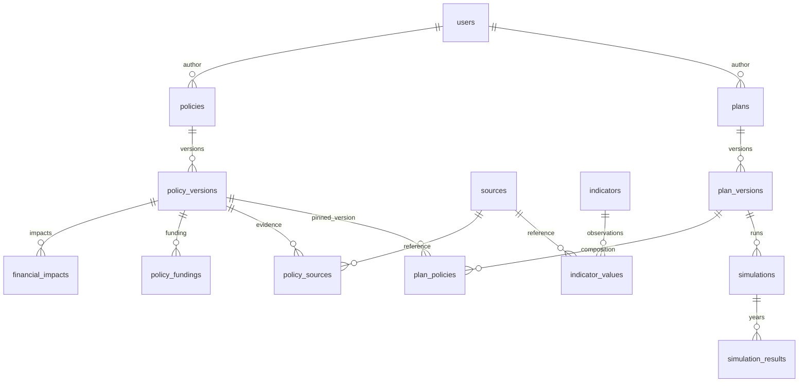

# Modelo conceitual da V1

As 14 tabelas do núcleo estão implementadas em SQLAlchemy e nas migrations 0001/0002. Constraints e triggers PostgreSQL protegem versões publicadas e seus dependentes. A migration 0003 adiciona auth_sessions, refresh_tokens e auth_rate_limits para sessões revogáveis e proteção contra abuso.

## Entidades principais

| Tabela | Conteúdo e relações |
| --- | --- |
| users | UUID, nome, username/email únicos, password_hash, USER/ADMIN, ativo, created_at/updated_at |
| policies | UUID, autor, slug único, DRAFT/PUBLISHED/ARCHIVED, current_version_id publicado, datas |
| policy_versions | UUID, policy_id, created_by, número, DRAFT/PUBLISHED, título/resumo/problema/solução/categoria, período, financial_impact_status, resumo da mudança, created_at/published_at |
| sources | UUID, criador, título/instituição/URL/tipo, publicação/acesso/descrição, datas |
| policy_sources | policy_version_id, source_id, descrição do uso e snapshot de metadados citados |
| financial_impacts | policy_version_id, ano, tipo, magnitude NUMERIC(18,2), descrição/premissas |
| policy_fundings | policy_version_id, tipo, valor opcional, descrição; período/ano a definir para comparar cobertura |
| indicators | código único, nome/descrição/categoria/unidade/frequência, abrangência/método/ano-base, ativo, datas |
| indicator_values | indicator_id, referência, valor NUMERIC(20,6), source_id, coletado em, revisão/proveniência |
| plans | UUID, autor, slug único, estado, current_version_id publicado, datas |
| plan_versions | plan_id, created_by, número, DRAFT/PUBLISHED, título/resumo/visão, ano inicial/final, resumo de mudança e datas |
| plan_policies | plan_version_id, policy_version_id, posição, habilitada, data |
| simulations | plan_version_id, calculation_version, snapshot/hash das entradas, premissas, data |
| simulation_results | simulation_id, ano, quatro parcelas, líquido NUMERIC(18,2), avisos e data |

As 14 tabelas são o núcleo conceitual. As três tabelas de autenticação e a tabela audit_events completam o suporte operacional. Avisos/snapshots podem usar JSONB quando apropriado; a escolha deve ser documentada na migration.

## Constraints e invariantes

- UUID em identidades; dinheiro Decimal/NUMERIC; timestamps com timezone em UTC.
- UNIQUE(parent_id, version_number) e no máximo um rascunho ativo por proposta/plano.
- `current_version_id` aponta para uma versão publicada da própria identidade; criar novo draft não altera o ponteiro público.
- UNIQUE(plan_version_id, policy_version_id); posições não negativas e ordem determinística.
- Magnitudes fiscais finitas e não negativas, com até centavos; períodos com início ≤ fim.
- Publicar plano somente com versões publicadas de propostas. Nunca atualizar referências automaticamente para versões mais novas.
- Conteúdo de versões publicadas, seus impactos, fontes/snapshots, financiamento e composição não pode ser editado ou excluído fisicamente.
- Arquivar a identidade preserva versões anteriores e resultados. Exibir estado/motivo no histórico sem alterar seu conteúdo.
- Fontes compartilhadas não são excluídas se referenciadas. Correção do catálogo preserva snapshot citado anteriormente.
- Fonte ligada somente a rascunho e dados de usuário não são retornados por API pública.

## Enumerações principais

Estado da versão: DRAFT/PUBLISHED. Estado da identidade: DRAFT/PUBLISHED/ARCHIVED.

Estado fiscal: ESTIMATED/NOT_ESTIMATED/NOT_APPLICABLE. Tipo de impacto: NEW_EXPENSE/EXPENSE_REDUCTION/NEW_REVENUE/REVENUE_REDUCTION.

Financiamento: SPENDING_CUT/NEW_REVENUE/TAX_INCREASE/DEBT/PROGRAM_REPLACEMENT/REVENUE_GROWTH/UNFUNDED/OTHER.

Fonte: OFFICIAL/LEGISLATION/SCIENTIFIC_STUDY/TECHNICAL_REPORT/INSTITUTIONAL_REPORT/JOURNALISM/OTHER. Categorias de propostas correspondem às listadas em V1_SCOPE.

## Sequência de publicação

Validar autoria → obter rascunho e controlar concorrência → validar campos/referências → congelar snapshots → marcar versão publicada → atualizar ponteiro da identidade → commit. Planos também congelam composição e execução fiscal de referência.

Casos de teste obrigatórios: edição após publicação, criação simultânea de versões, tentativa de alterar versão de outro autor, proposta v2 sem mudança em plano v1, correção de fonte sem mudança em snapshot antigo e não vazamento de rascunho.

## Implementação F1-01

Estados e tipos usam VARCHAR com CHECK, evitando enums nativos difíceis de migrar. Ponteiros públicos e itens de plano usam chaves estrangeiras compostas que exigem pertencimento e estado PUBLISHED. Índices parciais limitam um rascunho por identidade. Triggers bloqueiam INSERT/UPDATE/DELETE em conteúdo de versões publicadas e usam bloqueio da versão para sincronizar alterações e publicação. Revisões de indicadores têm número e proveniência JSONB; financiamento tem ano opcional. Requisitos editoriais são validados pelos serviços implementados em F1-05/F1-06.

## Simulações implementadas

Migrations 0004/0005 adicionam status DRAFT/COMPLETED e completed_at nas execuções, referência composta da versão do plano à própria execução concluída e triggers de congelamento dos resultados. Publicar plano gera execução e congela seu identificador na mesma transação. Alterar rascunho invalida sua referência ao cálculo anterior, preservando a execução histórica.

## Auditoria e revisão de indicadores

A migration 0006 adiciona audit_events com actor_id, entidade/id, ação, motivo, detalhes limitados à manutenção e created_at UTC. Triggers recusam UPDATE/DELETE da auditoria e de indicator_values. Correções de valores criam novas revisões serializadas pelo lock do indicador. Não há alteração destrutiva de observações na API administrativa.

## Metadados fiscais — migration 0009

FinancialImpact acrescenta fiscal_scope, accounting_basis, price_basis, price_base_year, component e period_basis, com domínios/constraints validados. Defaults UNSPECIFIED/null preservam a ausência no legado. Serviços de propostas, cópias e composição de planos transportam os campos. Avaliação versionada em input_snapshot/assumptions da execução; nenhuma tabela de projeção foi adicionada. [Contrato completo](../data/FISCAL_COMPATIBILITY.md).

## Cenário opcional — migration 0010

PlanVersion.fiscal_scenario é JSONB nullable: premissas anuais autorais e estado de revisão (declaração de exclusão, hash e timestamp UTC). Defaults null preservam planos anteriores; trigger existente protege a nova coluna em publicações. Não há UPDATE de versões antigas. Simulations.input_snapshot inclui cenário/revisão/método apenas quando ativo; assumptions.fiscal_scenario preserva a saída exata do motor, com decimais em strings. SimulationResult conserva os totais incrementais anteriores; declared/combined ficam no snapshot imutável da execução. [Contrato](../data/FISCAL_SCENARIOS.md).

## Conjuntos funcionais — migration 0011

FiscalSpendingCohort guarda ano/revisão, fonte/autor/coleta, SHA-256, versões de parser/precisão, snapshot de fonte e agregados JSONB com dinheiro string. Unicidade por revisão de arquivo/método e trigger append-only impedem reescrita; correção gera novo conjunto completo. Ausência de grupo não se converte em observação zero. Não altera versões, impactos ou snapshots anteriores. [Contrato](../data/FISCAL_SPENDING.md).

## EFGG por esfera — migration 0012

`general_government_cohorts`: revisão anual, fonte/autor/coleta UTC, SHA-256, versões parser/precisão, fingerprint, fonte congelada e payload JSONB de valores monetários string. Revisão inteira validada em transação, append-only via trigger, unicidade por ano/revisão e arquivo/versões. Conjunto próprio, sem indicador-sentinela ou alteração das versões/snapshots/motor existentes. [Contrato](../data/GENERAL_GOVERNMENT.md).

## Contextos e evidências — migration 0013

`contexts`: identidade/autor/selo de exemplo imutáveis. `context_versions`: revisions sequenciais, criador, payload ContextDraft JSONB com números em string, hash do contrato/conteúdo e data. `context_reviews`: número sequencial por versão, revisor/decisão e registro vinculado ao ID/revisão/hash. `context_publications`: versão, revisão aceita, publicador/data/hash; publicação única por versão, alvo por FKs compostas.

Quatro tabelas append-only inclusive rascunhos/decisões; editar acrescenta outra versão, sem herdar aceitação. Gates SQL conferem autoria/identidade e última aceitação autorizada; referência real e revisão humana são responsabilidades do serviço. Nenhuma nova coluna em propostas/planos/simulações/indicadores/fontes, nenhum efeito fiscal. [Contrato](../data/CONTEXT_EVIDENCE.md).

## Grafo — migration 0014

GRAPH-01A conserva os modelos puros; GRAPH-01B acrescenta nove tabelas: `graph_nodes`, `graph_node_versions`, `graph_edges`, `graph_edge_versions`, `graph_edge_reviews`, `graph_edge_publications`, `graph_collections`, `graph_collection_versions` e `graph_collection_publications`.

Identidades guardam autor/selo de exemplo; versões sequenciais guardam payload JSONB, hash e criador. Arestas têm FKs para versões exatas dos dois nós, e revisão/publicação têm FKs compostas para versão/hash/alvo. Coleção preserva snapshot e arrays ordenados de IDs de versões, conferidos por gates SQL; arrays não são FKs convencionais. Todas as nove tabelas são append-only, inclusive rascunhos e decisões. Gates conferem autoria, sequência, alvo, última revisão e dependências publicadas; a camada de serviço resolve referências/visibilidade e valida conteúdo/hash canônico.

Nenhuma coluna ou cálculo foi acrescentado a propostas, planos, indicadores ou simulações. Upgrade com backup antes de dados úteis; downgrade somente em banco exclusivo de integração. [Contrato](../data/GRAPH_CONTRACT.md).
